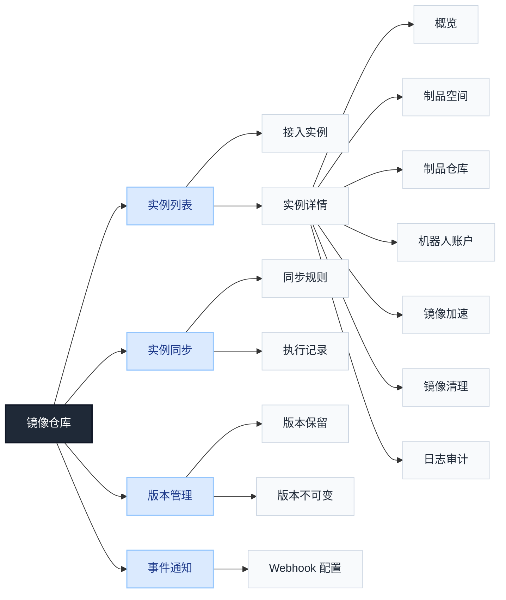
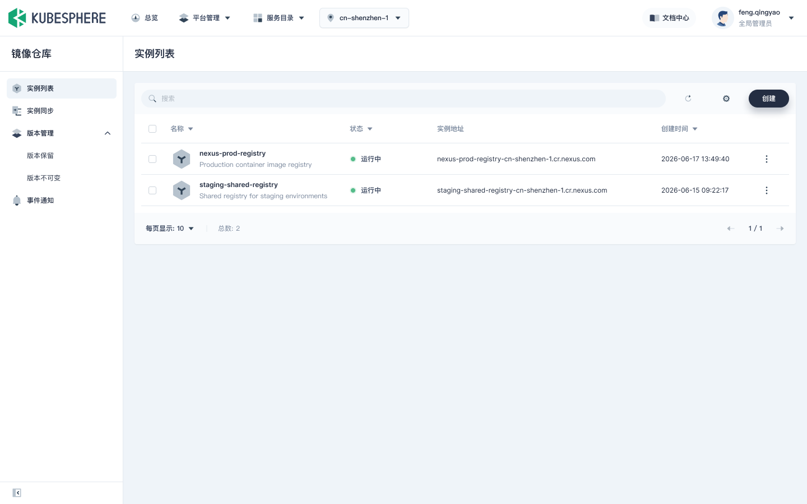
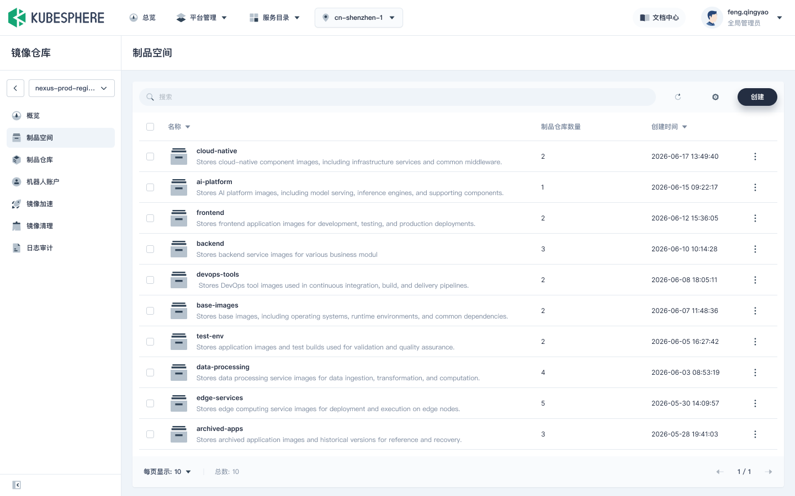
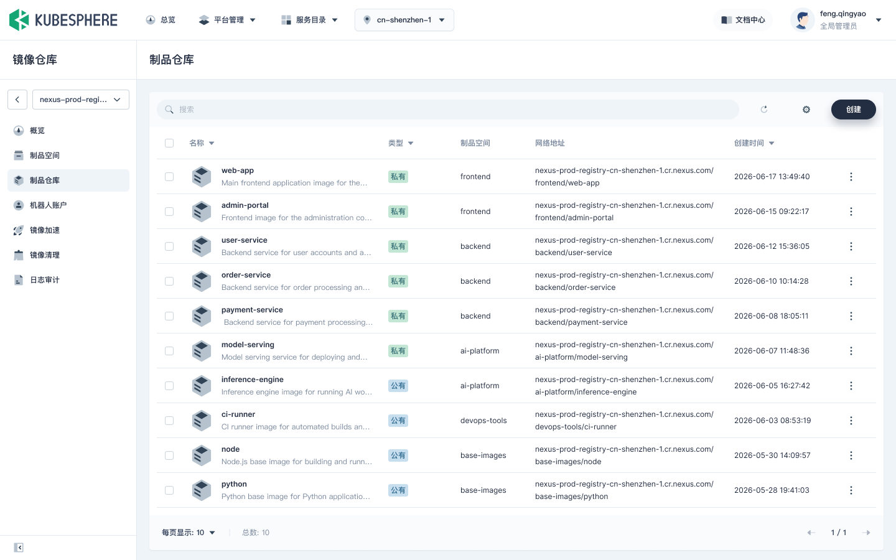
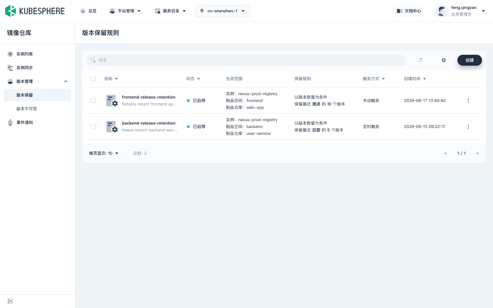
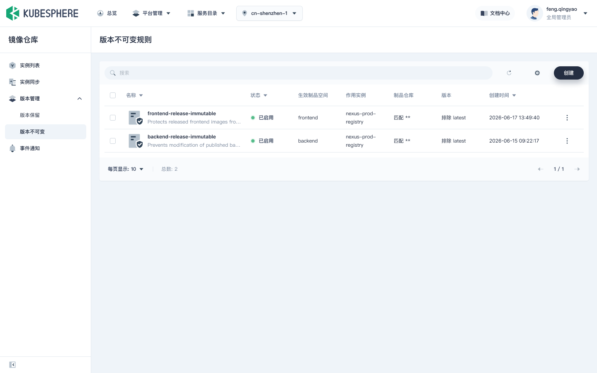
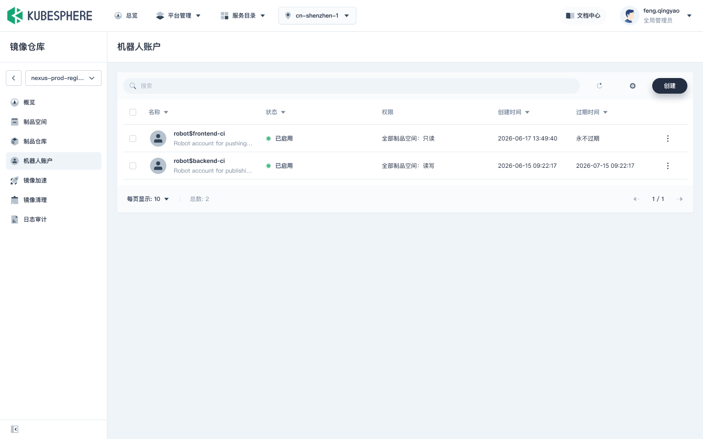

# 镜像仓库产品设计概览



## 目录

- [1. 产品功能菜单结构](#1-产品功能菜单结构)
- [2. 功能规划范围](#2-功能规划范围)
- [3. 角色权限摘要](#3-角色权限摘要)
- [4. 实例管理](#4-实例管理)
- [5. 实例同步](#5-实例同步)
- [6. 实例复制](#6-实例复制)
- [7. 制品空间管理](#7-制品空间管理)
- [8. 制品仓库与制品管理](#8-制品仓库与制品管理)
- [9. 版本管理](#9-版本管理)
- [10. 机器人账户](#10-机器人账户)
- [11. 镜像加速](#11-镜像加速)
- [12. 日志审计](#12-日志审计)
- [13. 实例访问凭证与使用指引](#13-实例访问凭证与使用指引)
- [14. 镜像安全扫描](#14-镜像安全扫描)
- [15. 事件通知](#15-事件通知)
- [16. 镜像清理](#16-镜像清理)

## 1. 产品功能菜单结构

```text
镜像仓库
├── 实例列表
│   ├── 接入实例
│   └── 实例详情
│       ├── 概览
│       ├── 制品空间
│       ├── 制品仓库
│       ├── 机器人账户
│       ├── 镜像加速
│       ├── 镜像清理
│       └── 日志审计
├── 实例同步
│   ├── 同步规则
│   └── 执行记录
├── 版本管理
│   ├── 版本保留
│   └── 版本不可变
└── 事件通知
    └── Webhook 配置
```

补充说明：

- 实例详情固定当前 Harbor 实例上下文，不提供实例切换器；需要切换实例时返回实例列表。
- 制品仓库、Artifact、Tag 的浏览和管理在实例详情的“制品仓库”中完成。
- 使用指引是实例、制品空间、Repository 和 Artifact 详情中的上下文快捷入口，不单独占用左侧菜单。
- 实例复制是 Artifact/Tag 详情中的一次性操作，不单独占用一级菜单。
- Harbor Project 在产品中统一称为“制品空间”。

## 2. 功能规划范围

| 编号 | 功能 | 功能用途 | 状态 | 页面位置或边界 |
| --- | --- | --- | --- | --- |
| 1 | 实例管理 | 接入并管理 Harbor 实例，让用户能定位实例并了解其连接状态和资源概况 | 当前设计范围 | 实例列表、实例接入、实例详情、连接状态、解除纳管 |
| 2 | 实例访问凭证 | 帮助用户生成登录、推送和拉取所需命令，正确访问镜像仓库 | 当前设计范围 | 登录、推送、拉取命令和使用指引；不建设凭证中心 |
| 3 | 实例同步 | 按规则将源实例中的制品持续同步到目标实例，支持查看每次执行结果 | 需确认 | 一级页面管理同步规则和执行记录；平台级规则由全局管理员维护 |
| 4 | 实例复制 | 将选定的 Artifact/Tag 一次性复制到目标实例，满足迁移或临时分发需求 | 当前设计范围，完整克隆需单独规划 | 指定 Artifact/Tag 复制到其他实例；不建设全实例克隆页面 |
| 5 | 事件通知 / 触发器 / Webhook | 按事件或计划触发同步，并向外部系统发送制品事件通知 | 当前设计范围 | 同步触发器归入同步规则；Webhook 归入事件通知 |
| 6 | 制品空间管理 | 按团队或业务边界组织制品，查看资源用量并控制配额 | 当前设计范围 | 制品空间创建、编辑、删除、用量和配额 |
| 7 | 制品仓库管理 | 浏览、检索和管理仓库中的镜像及 OCI 制品 | 当前设计范围 | Repository、Artifact、Tag 和 OCI 制品管理 |
| 8 | 制品管理 | 查看单个制品的摘要、Tag、元数据和可执行操作 | 当前设计范围 | 与“制品仓库”融合，覆盖 Artifact 详情、Tag 和制品操作 |
| 9 | 版本管理 | 控制制品版本的保留周期和 Tag 覆盖行为，降低误删或覆盖风险 | 当前设计范围 | 版本保留、版本不可变 |
| 10 | 机器人账户 | 为 CI/CD 等自动化任务提供受制品空间权限约束的访问身份 | 当前设计范围 | 实例内按制品空间汇总查看，创建和授权以制品空间为边界 |
| 11 | P2P 镜像加速 | 加速集群节点获取镜像，降低重复下载带来的网络和拉取耗时 | 需技术验证 | 实例级加速组件、节点接入、加速策略和运行状态 |
| 12 | 日志审计 | 追溯谁在何时对哪些制品资源执行了什么操作及其结果 | 当前设计范围 | 查看实例可获取的项目/制品空间操作日志 |
| 13 | 镜像安全扫描 | 识别镜像中的已知漏洞，帮助用户评估制品安全风险 | 需技术验证 | 扫描任务、扫描状态和漏洞报告，依赖扫描器 API |
| 14 | 镜像清理 | 清理不再需要的制品版本，并在适用时回收实例存储空间 | 规划边界 | 实例级清理任务、影响预览、执行记录；与版本保留分开 |

## 3. 角色权限摘要

| 角色 | 主要能力 |
| --- | --- |
| 全局管理员 | 管理平台纳管实例、实例接入和解除纳管；维护平台级实例同步规则；处理跨 Region、跨 Tenant 同步 |
| 租户管理员 | 在 Tenant 资源池和授权范围内查看或管理实例及制品资源；不能创建平台级同步规则 |
| 项目管理员 | 管理 Tenant 项目成员、用户组和访问策略；在授权范围内管理制品资源、版本规则和 Webhook |
| 普通用户 | 使用被授权的实例、制品空间、Repository、Artifact 和 Tag；不显示平台管理入口 |
| Harbor 角色 | system-admin、project-admin、maintainer、developer、guest/limited-guest 等作为底层权限依据 |

Tenant 项目、成员、用户组、资源组和访问策略由平台通用能力管理，镜像仓库不重复建设一套用户和用户组体系。

## 4. 实例管理

### 4.1 菜单结构

```text
实例列表
├── 接入实例
└── 实例详情
    ├── 概览
    ├── 制品空间
    ├── 制品仓库
    ├── 机器人账户
    ├── 镜像加速
    ├── 镜像清理
    └── 日志审计
```

### 4.2 实例列表字段

| 字段 | 说明 |
| --- | --- |
| 实例名称 | 平台内实例名称 |
| Region | 实例所属 Region |
| 实例地址 | Harbor Registry 地址 |
| 连接状态 | 运行中、异常、未知 |
| 制品空间数 | 可展示，当前实例可获取的制品空间数量 |
| 仓库/制品数量 | 可获取时展示，允许异步或缓存 |
| 最近检查时间 | 可展示，最近一次连接检查时间 |
| 创建时间 | 平台纳管记录创建时间 |
| 操作 | 查看、编辑、检查连接、解除纳管 |



### 4.3 接入实例字段

| 字段 | 必填 | 说明 |
| --- | --- | --- |
| Region | 是 | 实例归属 Region，接入后不可直接更改 |
| 实例名称 | 是 | 同一 Region 内唯一 |
| 实例地址 | 是 | 同一 Region 内不可重复 |
| 管理员账号 | 是 | 需要目标 Harbor 的 system-admin 权限 |
| 管理员密码/凭证 | 是 | 用于连接校验和后续管理，不回显、不写普通日志 |

### 4.4 实例概览字段

实例名称、Region、实例地址、连接状态、最近检查时间、可访问制品空间数量、仓库/制品摘要。

## 5. 实例同步

### 5.1 菜单结构

```text
实例同步
├── 同步规则
│   ├── 规则列表
│   ├── 创建同步规则
│   └── 规则详情
└── 执行记录
    ├── 执行记录列表
    └── 执行详情
        ├── 执行摘要
        ├── 制品任务
        └── 任务日志
```

### 5.2 同步规则列表字段

规则名称、源 Tenant、源实例、源 Region、目标 Tenant、目标实例、目标 Region、同步范围摘要、触发方式、规则启用状态、最近执行时间、最近执行结果、更新时间、操作。

### 5.3 创建/编辑同步规则字段

| 分组 | 字段 |
| --- | --- |
| 基本信息 | 规则名称、描述 |
| 源端 | 源 Tenant、源实例、源 Region |
| 目标端 | 目标 Tenant、目标实例、目标 Region、目标制品空间 |
| 制品范围 | 整个制品空间 / 按规则筛选、制品空间、仓库路径、Tag、资源类型 |
| 触发方式 | 手动、定时、事件触发（技术能力验证后开放） |
| 同步策略 | 是否覆盖目标端同名制品、源端删除时是否删除目标端制品 |
| 校验结果 | 实例连接、凭证、写入权限、版本兼容性 |

### 5.4 执行记录字段

执行 ID、规则名称、源 Tenant/实例、目标 Tenant/实例、触发方式、开始时间、结束时间、执行状态、成功/失败任务数、操作。

执行详情包括执行摘要、制品任务、错误摘要和任务日志。

## 6. 实例复制

### 6.1 页面入口

```text
制品仓库
└── Artifact/Tag 详情
    └── 复制到其他实例
```

### 6.2 复制参数

| 字段 | 说明 |
| --- | --- |
| 目标 Tenant | 目标租户 |
| 目标实例 | 目标 Harbor 实例 |
| 目标 Region | 随目标实例展示 |
| 目标制品空间 | 目标写入空间 |
| 冲突处理 | 处理同名 Tag 或不同 digest 的冲突 |

实例复制是一次性制品复制，不提供定时、事件触发、源端删除和长期规则配置；完整 Harbor 实例克隆另行规划。

## 7. 制品空间管理

### 7.1 菜单结构

```text
实例详情
└── 制品空间
    ├── 制品空间列表
    ├── 创建制品空间
    └── 制品空间详情
        ├── 概览/基础信息
        ├── 仓库列表
        ├── 配额与用量
        └── 机器人账户
```

### 7.2 制品空间列表字段

名称、制品仓库数量、创建时间、操作。



### 7.3 创建/编辑制品空间字段

| 字段 | 必填 | 说明 |
| --- | --- | --- |
| 名称 | 是 | 遵循 Harbor 命名规则 |
| 描述 | 否 | 制品空间说明 |
| 可见性 | 按 API | 公开/私有等实际支持的选项 |

### 7.4 配额与用量字段

当前用量、配额上限、使用比例、更新时间、超限行为说明。配额是否可编辑取决于目标 Harbor 能力。

## 8. 制品仓库与制品管理

### 8.1 菜单结构

```text
实例详情
└── 制品仓库
    ├── Repository 列表
    ├── Repository 详情
    ├── Artifact 列表
    ├── Artifact 详情
    └── Tag 列表/详情
```

### 8.2 Repository 字段

仓库名称、类型、所属制品空间、网络地址、创建时间、操作。



### 8.3 Artifact 字段

制品标识/摘要、仓库路径、Tag、媒体类型/制品类型、大小、推送/创建时间、扫描状态、操作。

### 8.4 Artifact 详情字段

仓库路径、digest、Tag 列表、媒体类型/OCI 类型、大小、创建/推送时间、Manifest/平台架构信息、扫描状态/报告、操作日志关联。

### 8.5 Tag 字段和操作

Tag 名称、关联 digest、更新时间。支持查看关联 Artifact；删除或修改操作按 Harbor API 和角色权限展示。

## 9. 版本管理

### 9.1 菜单结构

```text
版本管理
├── 版本保留
└── 版本不可变
```

### 9.2 版本保留字段

规则名称、作用实例、作用制品空间/仓库范围、匹配条件、保留规则、启用状态、触发方式、创建时间、操作。

配置字段包括：作用实例、作用制品空间或仓库范围、仓库/Tag 匹配条件、保留最近 N 个或按时间保留、启用状态、执行或预览能力。



### 9.3 版本不可变字段

规则名称、启用状态、作用实例、生效制品空间、仓库匹配条件、Tag /版本匹配规则、创建时间、操作。

版本不可变不在实例详情中重复建设；制品空间、Repository 或 Tag 页面可以提供带当前上下文的快捷入口。



## 10. 机器人账户

### 10.1 菜单结构

```text
实例详情
└── 机器人账户
    ├── 按制品空间筛选
    ├── 账户列表
    ├── 创建机器人账户
    └── 创建成功凭证页
```

### 10.2 账户列表字段

机器人账户名称、启用状态、权限范围、创建时间、到期时间/到期状态、操作。



### 10.3 创建机器人账户字段

| 字段 | 必填 | 说明 |
| --- | --- | --- |
| 名称 | 是 | 机器人账户名称 |
| 所属制品空间 | 是 | 账户资源归属和授权边界 |
| 权限 | 是 | 按制品空间授予推送/拉取等权限 |
| 到期时间 | 否 | API 支持且平台策略允许时提供 |

创建成功页仅展示一次密钥/令牌，并提供复制凭证和示例登录命令。

## 11. 镜像加速

### 11.1 菜单结构

```text
实例详情
└── 镜像加速
    ├── 加速组件状态
    ├── 集群/节点接入
    ├── 加速策略
    └── 运行状态与告警
```

### 11.2 页面字段

加速组件状态、组件版本、集群/节点接入状态、节点数量、加速策略、运行状态、告警信息、网络/代理/证书状态、失败回退状态。

该能力依赖 P2P 组件、集群接入、运行时链路和运维职责确认；不与 Harbor 实例同步规则混用。

## 12. 日志审计

### 12.1 菜单结构

```text
实例详情
└── 日志审计
    ├── 日志列表
    └── 日志详情
```

### 12.2 日志字段

操作时间、操作主体、操作类型/动作、目标资源、结果/状态、来源地址、详情操作。

### 12.3 筛选字段

时间范围、操作主体、操作类型、资源类型/资源名称、结果状态。

日志范围以 Harbor 实际可提供的项目/制品空间操作记录为准，不承诺完整平台级审计中心。

## 13. 实例访问凭证与使用指引

### 13.1 页面入口

```text
实例详情
└── 使用指引（上下文快捷入口）
    ├── 登录镜像仓库
    ├── 推送镜像
    └── 拉取镜像
```

### 13.2 指引参数

| 场景 | 参数 |
| --- | --- |
| 登录 | 实例 Registry 地址、客户端类型 |
| 推送 | 实例地址、制品空间、仓库路径、目标 Tag |
| 拉取 | 实例地址、制品空间、仓库路径、Artifact/Tag |

命令由当前实例、制品空间、Repository 和 Tag 上下文生成，不直接拼接用户密码或长期秘密。

## 14. 镜像安全扫描

### 14.1 菜单结构

```text
制品仓库
└── Artifact 详情
    └── 镜像安全扫描（技术验证后开放）
        ├── 扫描任务列表
        ├── 制品扫描详情
        └── 漏洞报告
```

### 14.2 扫描列表字段

实例、制品空间、仓库路径、Artifact digest/Tag、扫描状态、扫描时间、漏洞等级统计、操作。

### 14.3 漏洞报告字段

扫描状态、扫描时间、扫描器信息、漏洞标识、严重等级、受影响组件、当前版本、修复版本。

页面开放依赖目标 Harbor 版本、扫描器、触发扫描 API、状态查询 API 和漏洞报告 API。

## 15. 事件通知

### 15.1 菜单结构

```text
事件通知
└── Webhook 配置
    ├── Webhook 列表
    ├── 创建/编辑 Webhook
    └── 投递记录
```

### 15.2 Webhook 列表字段

名称、所属 Harbor 实例、所属制品空间、目标 URL、订阅事件摘要、启用状态、最近投递状态/时间、操作。

### 15.3 创建/编辑 Webhook 字段

名称、作用实例、作用制品空间、目标 URL、订阅事件、认证/Secret、启用状态。

### 15.4 投递记录字段

事件时间、事件类型、目标 URL、投递状态、HTTP 状态码、重试次数/错误摘要、详情操作。

定时触发器属于实例同步规则的触发方式；Webhook 用于向外部系统发送 Harbor 事件，两者不共用配置对象。

## 16. 镜像清理

### 16.1 菜单结构

```text
实例详情
└── 镜像清理
    ├── 清理任务
    ├── 影响预览
    ├── 执行记录
    └── 任务详情
```

### 16.2 清理任务字段

任务名称、作用实例、作用制品空间/仓库范围、清理类型、匹配条件、影响预览、维护窗口、执行状态、最近执行时间、操作。

### 16.3 执行记录字段

任务 ID、任务名称、开始时间、结束时间、执行状态、处理数量、释放空间、失败数量、错误摘要、任务日志。

版本保留负责决定哪些版本保留或删除；镜像清理负责实例级清理任务和可能的 GC。两者不合并为同一页面，也不承诺删除制品后存储空间立即释放。

