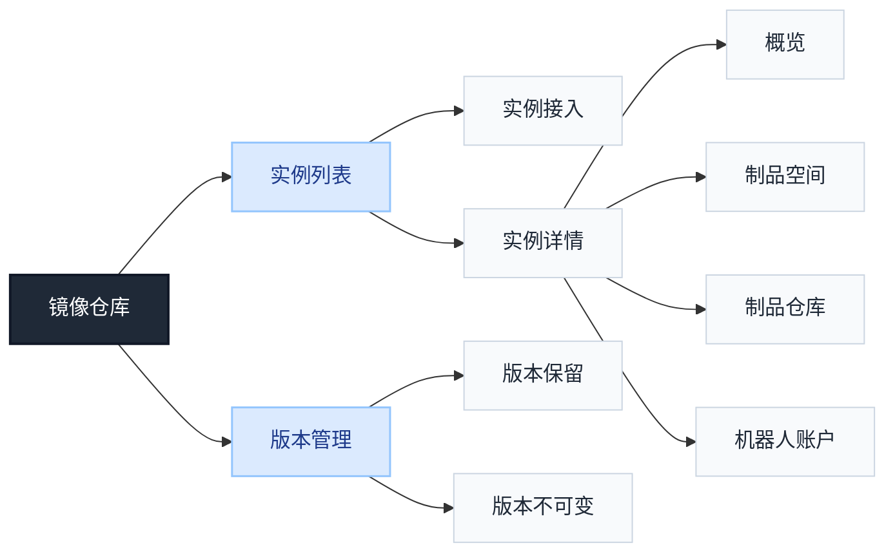

# 镜像仓库功能优先级规划



## 目录

- [镜像仓库功能优先级规划](#镜像仓库功能优先级规划)
  - [目录](#目录)
  - [1. 功能结构](#1-功能结构)
  - [2. 功能优先级与规划范围](#2-功能优先级与规划范围)
  - [3. 角色与菜单权限](#3-角色与菜单权限)
    - [3.1 角色能力](#31-角色能力)
    - [3.2 菜单可见范围](#32-菜单可见范围)
    - [3.3 权限判断原则](#33-权限判断原则)
  - [4. 功能设计](#4-功能设计)
    - [4.1 实例管理](#41-实例管理)
      - [实例列表](#实例列表)
      - [实例接入](#实例接入)
        - [接入已有实例](#接入已有实例)
        - [创建新实例](#创建新实例)
      - [实例概览](#实例概览)
      - [实例管理操作](#实例管理操作)
    - [4.2 制品空间管理](#42-制品空间管理)
      - [制品空间列表](#制品空间列表)
      - [创建/编辑制品空间](#创建编辑制品空间)
      - [配额与用量](#配额与用量)
    - [4.3 制品仓库管理](#43-制品仓库管理)
      - [Repository 列表](#repository-列表)
      - [Repository 详情](#repository-详情)
      - [仓库操作与边界](#仓库操作与边界)
    - [4.4 制品管理](#44-制品管理)
      - [Artifact 列表](#artifact-列表)
      - [Artifact 详情](#artifact-详情)
      - [Tag 列表](#tag-列表)
      - [添加 Tag](#添加-tag)
      - [制品与 Tag 操作](#制品与-tag-操作)
    - [4.5 实例访问凭证](#45-实例访问凭证)
      - [入口与上下文](#入口与上下文)
      - [登录信息与凭证来源](#登录信息与凭证来源)
      - [推送与拉取指引](#推送与拉取指引)
    - [4.6 版本管理](#46-版本管理)
      - [版本保留列表](#版本保留列表)
      - [创建/编辑版本保留](#创建编辑版本保留)
      - [版本保留执行记录](#版本保留执行记录)
      - [版本不可变列表](#版本不可变列表)
      - [创建/编辑版本不可变](#创建编辑版本不可变)
    - [4.7 机器人账户](#47-机器人账户)
      - [机器人账户列表](#机器人账户列表)
      - [创建机器人账户](#创建机器人账户)
  - [5. 暂缓功能](#5-暂缓功能)
  - [6. 优先级说明](#6-优先级说明)

## 1. 功能结构

```text
镜像仓库
└── 实例列表
    ├── 实例接入
    └── 实例详情
        ├── 概览
        ├── 制品空间
        ├── 制品仓库
        └── 机器人账户
└── 版本管理
    ├── 版本保留
    └── 版本不可变
```

说明：Harbor Project 在产品中称为“制品空间”。

## 2. 功能优先级与规划范围

| 编号 | 功能 | 优先级 | 状态 | 设计说明 |
| --- | --- | --- | --- | --- |
| 1 | 实例管理 | P0 | 支持 | 通过实例列表接入已有 Harbor 或创建新实例，并在实例详情查看连接状态及资源概况。 |
| 2 | 实例访问凭证 | P0 | 支持 | 根据当前实例和制品上下文生成登录、推送、拉取命令及使用指引。 |
| 3 | 制品空间管理 | P0 | 支持 | 提供制品空间列表、创建编辑、详情，以及用量和配额查看。 |
| 4 | 制品仓库管理 | P0 | 支持 | 按制品空间查看和筛选 Repository，展示仓库路径、资源数量及可用操作。 |
| 5 | 制品管理 | P0 | 支持 | 查看 Artifact、Tag 和 OCI 制品的元数据，并按权限执行制品操作。 |
| 6 | 机器人账户 | P0 | 支持 | 按制品空间管理机器人账户及其权限，创建时安全展示凭证。 |
| 7 | 版本管理 | P0 | 支持 | 集中管理版本保留和版本不可变规则，并明确实例及制品空间范围。 |
| 8 | 实例同步 | P1 | 暂不支持 | 配置源实例、目标实例和制品范围，并查看长期同步规则的执行记录。 |
| 9 | 审计日志 | P1 | 暂不支持 | 按时间、操作人、资源和结果筛选操作日志，并查看单条记录详情。 |
| 10 | 事件通知 | P1 | 暂不支持 | 通过 Webhook 按实例和制品空间配置事件订阅及目标地址，并查看通知投递结果。 |
| 11 | 镜像清理 | P1 | 暂不支持 | 按实例管理清理任务，通过影响预览和执行记录跟踪清理过程；不包含版本保留。 |
| 12 | 实例复制 | P2 | 暂不支持 | 从 Artifact/Tag 详情发起一次性复制，选择目标实例和制品空间并处理冲突。 |
| 13 | 镜像加速 | P2 | 暂不支持 | 集中呈现加速组件、集群/节点接入、加速策略和运行状态。 |
| 14 | 镜像安全扫描 | P2 | 暂不支持 | 在制品上下文查看扫描状态、漏洞等级统计和漏洞明细。 |

## 3. 角色与菜单权限

### 3.1 角色能力

| 角色 | 主要能力 |
| --- | --- |
| 全局管理员 | 管理平台纳管实例、实例接入和解除纳管；管理平台范围内版本策略；处理跨 Region 资源管理 |
| 租户管理员 | 在 Tenant 资源池及授权范围内管理实例和制品资源；不能通过实例接入扩大资源池 |
| 项目管理员 | 管理 Tenant 项目成员、用户组和访问策略；在授权制品空间内管理资源和版本策略 |
| 普通用户 | 使用被授权的实例、制品空间、Repository、Artifact 和 Tag；不能进入平台管理操作 |
| Harbor 角色 | system-admin、project-admin、maintainer、developer、guest/limited-guest 等决定 Harbor 内部具体操作能力 |

Tenant 项目、成员、用户组、资源组和访问策略由平台通用能力管理，镜像仓库不重复设计用户和用户组体系。

### 3.2 菜单可见范围

| 菜单 | 全局管理员 | 租户管理员 | 项目管理员 | 普通用户 |
| --- | --- | --- | --- | --- |
| 实例列表 | 查看管理全部实例 | 查看 Tenant 资源池内实例，按授权管理 | 查看有权限访问的实例 | 查看有权限访问的实例 |
| 实例详情-概览 | 查看 | 查看授权实例 | 查看授权实例 | 查看授权实例 |
| 实例详情-制品空间 | 按 Harbor 角色管理 | 按 Harbor 角色管理或查看 | 查看、管理项目授权空间 | 查看被授权空间 |
| 实例详情-制品仓库 | 按 Harbor 角色管理 | 按 Harbor 角色管理 | 按项目授权和 Harbor 角色操作 | 按授权查看、拉取或执行其他允许的操作 |
| 实例详情-机器人账户 | 按制品空间创建、查看、编辑、启停、重置密钥和删除 | 按授权制品空间管理 | 按项目授权和 Harbor 角色管理 | 默认不显示；具体由产品角色策略确定 |
| 版本管理-版本保留 | 管理平台授权范围 | 管理租户授权范围 | 管理项目授权范围 | 默认只读或不显示 |
| 版本管理-版本不可变 | 管理平台授权范围 | 管理租户授权范围 | 管理项目授权范围 | 默认只读或不显示 |

暂缓功能不进入当前菜单；后续排期时，再按对应的实例范围、制品空间范围和角色权限补充可见规则。

### 3.3 权限判断原则

- 平台角色决定能否进入菜单及执行平台级管理操作。
- Tenant 资源池决定租户管理员可访问的 Harbor 实例范围。
- Tenant 项目和访问策略决定项目管理员、普通用户可访问的制品空间范围。
- Harbor 角色决定制品空间内的查看、推送、拉取、删除和规则配置操作。
- 最终权限取平台授权、Tenant 项目范围和 Harbor 角色的交集；菜单隐藏不能替代后端鉴权。

## 4. 功能设计

### 4.1 实例管理

统一管理接入已有 Harbor 和通过平台创建的 Harbor。两类实例共用列表与详情，按接入方式区分状态信息和移除行为。

**菜单结构**

```text
实例列表
├── 实例接入
└── 实例详情
    ├── 概览
    ├── 制品空间
    ├── 制品仓库
    └── 机器人账户
```

#### 实例列表

列表沿用顶部 Region 上下文，支持按名称搜索，仅展示当前角色可访问的实例；具备权限时提供“实例接入”。

| 字段 | 说明 |
| --- | --- |
| 实例名称 | 平台内识别实例的显示名称，点击进入详情；底层关联实例记录，不通过改名创建新实例 |
| Region | 实例所属区域，接入或创建后不可更改 |
| 实例模式（接入方式） | 接入已有实例（Onboarded）/ 创建新实例（Provisioned），用于区分来源与移除行为 |
| 实例地址 | Registry 访问地址，包含非默认端口时保留端口 |
| 实例状态 | 待处理、部署中、就绪、失败；详情展示连接、部署和身份开通的具体结果 |
| 创建时间 | 平台实例记录的创建时间，不是外部 Harbor 的原始部署时间 |
| 操作 | 查看、修改、连通性测试、移除，按当前角色和实例模式展示 |

列表数据取实例记录、连接信息和状态。制品空间（Harbor Project）、仓库及制品数量在实例详情查询，不作为列表必备统计字段。


#### 实例接入

先选择“接入已有实例”或“创建新实例”，再填写对应表单。Region 沿用顶部上下文并在表单只读展示，提交时固定归属。

##### 接入已有实例

表单按“连接信息 → 管理凭证”组织。

| 分组 | 字段 | 控件与必填 | 说明与校验 |
| --- | --- | --- | --- |
| 连接信息 | Region | 只读，必需 | 当前区域，接入后不可更改 |
| 连接信息 | 实例地址 | 文本框，必填 | 已部署 Harbor 的 Registry 地址；校验格式及同 Region 内地址唯一性 |
| 管理凭证 | 管理员账号 | 文本框，必填 | 目标 Harbor 的 system-admin 账号，提交时校验管理员身份 |
| 管理凭证 | 管理员密码 | 密码框，必填 | 用于连接及后续管理，安全保存，不回显历史值 |

不要求填写实例名称，接入后由平台生成实例记录，显示名称可通过修改操作调整。提交时校验健康状态及管理员身份；成功后进入实例详情或返回列表，失败时保留非敏感输入并展示原因，不提示接入成功。

##### 创建新实例

表单按“部署目标 → 实例信息 → 管理凭证”组织。

| 分组 | 字段 | 控件与必填 | 说明与校验 |
| --- | --- | --- | --- |
| 部署目标 | Region | 只读，必需 | 当前区域，创建后不可更改 |
| 部署目标 | 部署形态 | 固定展示 | 当前使用集群部署（Cluster）；主机部署（Node）保留模型，暂不开放 |
| 部署目标 | 目标集群 | 可搜索单选，必填 | 加载当前 Region 的可用集群；校验集群就绪及 Helm、StorageClass 等前置条件 |
| 实例信息 | 实例名称 | 文本框，必填 | 同 Region 内唯一 |
| 实例信息 | 实例地址 | 文本框，必填 | 规划的 Registry 地址，同 Region 内不可重复 |
| 实例信息 | 是否部署为 HTTPS | 开关或单选，必选 | 决定 HTTP/HTTPS；与地址显示保持一致，不增加未确认的证书配置字段 |
| 管理凭证 | admin 账号 | 文本框，必填 | 新实例的初始管理员账号，实际可设置方式以部署接口为准 |
| 管理凭证 | admin 密码 | 密码框，必填 | 新实例的初始管理凭证，安全保存，不回显历史值 |

命名空间由系统部署配置决定，不提供选择项。切换目标集群后重新校验就绪条件；提交成功表示部署请求已受理，状态依次为待处理、部署中、就绪或失败，不能将提交成功当作部署完成。

#### 实例概览

| 信息组 | 展示内容 |
| --- | --- |
| 基础信息 | 实例名称、Region、接入方式、Registry 地址 |
| 部署信息 | 仅新建实例展示部署形态、目标集群、部署状态和失败原因；命名空间如展示则为只读信息 |
| 连接信息 | 连通性、管理员身份校验和身份开通结果；有异常时展示具体原因 |
| 资源摘要 | 授权范围内的制品空间（Harbor Project）、仓库及制品数量；接口未提供时显示“--” |
| 使用指引 | 实例登录命令；推送与拉取结合具体空间、仓库和制品生成，见 4.5 |

#### 实例管理操作

**修改实例**

| 字段 | 控件与规则 |
| --- | --- |
| 实例名称 | 文本框，回填当前显示名称；修改不改变底层实例标识 |
| Region | 只读，不支持迁移归属 |
| 实例地址 | 文本框，回填当前地址；修改后重新校验格式、区域内唯一性及连通性 |

修改地址是更新连接信息，不负责迁移 Harbor 或制品数据；对于平台创建的实例，是否允许改地址及是否联动部署需与后端确认。管理员密码不作为普通信息回显。

| 操作 | 使用逻辑与影响 |
| --- | --- |
| 连通性测试 | 检查 Harbor 健康状态和管理员身份，展示结果及失败原因；不将单次测试成功等同于所有部署阶段就绪 |
| 移除接入实例 | 弹窗显示名称、地址及接入方式，确认仅解除纳管，不删除外部 Harbor 或制品数据 |
| 移除新建实例 | 明确是否级联卸载；接口支持时提供卸载选项，说明部署资源及数据影响后确认，数据处理方式以部署和存储配置为准 |

接入、修改、测试和移除分别按权限开放。管理员凭据仅供平台服务使用，不提供下载或复制为用户推拉凭证的入口。

### 4.2 制品空间管理

**菜单结构**

```text
实例详情
└── 制品空间
    ├── 制品空间列表
    ├── 创建制品空间
    └── 制品空间详情
        ├── 概览/基础信息
        ├── 仓库列表
        ├── 配额与用量
        └── 机器人账户
```

#### 制品空间列表

展示当前实例内用户有权访问的制品空间（Harbor Project）。所属实例沿用当前页面上下文，不要求重复选择。

| 字段 | 说明 |
| --- | --- |
| 名称 | 对应 Harbor Project 名称，同一实例内唯一；点击进入空间详情 |
| 可见性 | 公开 / 私有，表示整个空间的访问属性，适用于其下所有仓库 |
| 仓库数量 | 当前空间下的 Repository 数量；查询失败显示“--”，不能显示为 0 |
| 操作 | 查看详情、编辑、删除；按当前用户在目标 Harbor 中的实际权限开放 |

筛选字段：名称、可见性。提供“创建制品空间”入口，仅对具备创建权限的用户开放。

存储用量和配额统一在详情中展示。Artifact 数量、更新时间暂不列为基础列表字段，尚未明确其汇总方式和时间含义。

公开表示允许匿名读取或拉取 Harbor 开放的资源，不等于“仅当前 Tenant 可见”，也不赋予匿名推送或管理权限。需要租户内共享时，使用私有空间配合授权；不提供仓库级独立公有 / 私有设置。


#### 创建/编辑制品空间

| 字段 | 创建时 | 编辑时 | 说明 |
| --- | --- | --- | --- |
| 名称 | 必填 | 只读 | 遵循 Harbor 命名规则，同一实例内唯一；作为镜像路径的一部分，不提供改名操作 |
| 可见性 | 必选，默认私有 | 按权限修改 | 公开 / 私有；修改影响整个空间下的仓库，改为公开前需明确提示匿名访问范围并确认 |
| 存储配额 | 可配置 | 通过“修改配额”操作调整 | 设置具体容量或选择“不限制”；未指定时沿用 Harbor 默认配额，创建完成后显示实际生效值 |

详情中的基础信息展示名称、所属实例和可见性，仓库列表展示当前空间内的 Repository。成员、用户组和访问策略继续由 Tenant 项目管理统一维护。

删除前展示空间名称并二次确认；是否必须先清空仓库、是否允许删除非空空间，以目标 Harbor 的权限和删除校验结果为准。页面不默认执行级联清空，失败时显示具体阻止原因。

#### 配额与用量

| 字段 | 说明 |
| --- | --- |
| 存储用量 | 使用 Harbor 返回的空间存储计量值，与配额采用相同单位；不等同于实例磁盘的实际占用 |
| 配额上限 | 展示实际生效的具体容量或“不限制”；不能将继承默认配额显示为“未设置” |
| 使用比例 | 仅在配额为正的有限容量且用量可获取时计算；不限制、配额为 0 或查询失败时不显示比例 |

**操作**：具备配额管理权限时提供“修改配额”，填写具体容量或选择“不限制”；提交后刷新并展示实际生效值，失败时保留原值并说明原因。配额管理权限按 Harbor 实际授权判断，不仅凭平台角色名称决定。

**展示与提示**：用量或配额查询失败时分别显示“获取失败”，提供重试，不能显示为 0 或“不限制”。达到配额时，提示可能影响继续推送；具体限制及校验规则以 Harbor 返回结果为准。此处只管理空间存储配额，不增加仓库数量、Tag 数量或租户总容量配额。

### 4.3 制品仓库管理

**菜单结构**

```text
实例详情
└── 制品仓库
    ├── Repository 列表
    └── Repository 详情
        ├── 基本信息
        ├── 制品列表
        └── 推拉指引
```

#### Repository 列表

展示当前实例内有权限访问的仓库；从制品空间（Harbor Project）详情进入时固定所属空间，不要求重复选择。

| 字段 | 说明 |
| --- | --- |
| 仓库路径 | 显示“空间名称/仓库名称”，保留多级路径；点击进入详情，支持复制路径 |
| 所属制品空间（Harbor Project） | 当前仓库的归属；从空间详情进入时可省略该列 |
| 制品数量 | Artifact 数量，不能与 Tag 数量混用；无法获取时显示“--” |
| 操作 | 查看详情、推拉指引、删除，按实际权限开放 |

筛选字段为仓库路径、制品空间（Harbor Project）。跨空间汇总、搜索和分页方式需与接口确认；更新时间未明确含义前不作为基础字段。


#### Repository 详情

| 信息组 | 展示内容 |
| --- | --- |
| 基本信息 | 仓库路径、所属制品空间（Harbor Project）、Registry 地址、Artifact 数量 |
| 制品列表 | 当前仓库内的 Artifact，列表及详情字段见 4.4 |
| 推拉指引 | 当前仓库的 Docker/Helm 使用指引，已有路径自动带入，参数与命令见 4.5 |

#### 仓库操作与边界

| 操作 | 使用逻辑与影响 |
| --- | --- |
| 形成新仓库 | 向已有制品空间（Harbor Project）内的新路径首次成功推送制品后形成仓库；通过推送指引完成，不提供创建空仓库表单 |
| 查看推拉指引 | 自动带入实例、空间及仓库路径，填写必要参数后复制命令，在客户端执行 |
| 删除仓库 | 弹窗展示完整仓库路径及“影响仓库内制品和关联 Tag”的说明，确认后提交；受权限或不可变规则阻止时展示原因 |

仓库公开/私有属性沿用所属制品空间（Harbor Project），不提供独立开关。删除仓库不代表立即回收存储，不增加实例级镜像清理或 GC 操作。

### 4.4 制品管理

入口位于 Repository 详情，沿用实例、制品空间（Harbor Project）和仓库上下文，不重复选择。Artifact 以 Digest 标识，一份制品可关联多个 Tag，也可没有 Tag。

**页面结构**

```text
Repository 详情
└── 制品列表
    └── 制品详情
        ├── 基本信息
        ├── Tag 列表与添加 Tag
        ├── 制品元数据
        └── 拉取指引
```

#### Artifact 列表

以 Artifact 为一行，关联的多个 Tag 在同一行展示。

| 字段 | 说明 |
| --- | --- |
| Digest | 制品摘要，点击进入详情；可缩略展示，支持查看及复制完整值 |
| Tag | 多个 Tag 折叠展示；无 Tag 显示“无 Tag”，不补成 latest |
| 制品类型 | 按接口返回展示镜像、OCI Helm Chart 等；未识别类型保留原始值 |
| 大小 | Harbor 返回的制品大小，统一单位；不是解压大小或实例实际磁盘占用 |
| 推送时间 | 制品的推送时间，不与 Tag 创建时间、仓库更新时间混用 |
| 操作 | 查看、拉取指引、删除制品；删除 Tag 在 Tag 列表单独提供 |

按 Tag、Digest 查询，匹配方式以目标 Harbor 接口为准，不增加未确认的组合搜索或时间筛选。空列表提供推送指引；查询失败提供重试，缺失字段显示“--”，不能将失败当作空仓库。

#### Artifact 详情

| 信息组 | 展示内容 |
| --- | --- |
| 基本信息 | 完整 Digest、仓库路径、所属制品空间（Harbor Project）、类型、大小、推送时间 |
| Tag 列表 | 当前 Artifact 关联的全部 Tag，支持查看、添加及删除 |
| 制品元数据 | Manifest、媒体类型、操作系统和架构等实际返回信息；多架构镜像可展示子制品 Digest 与平台，不支持解析时仅展示可获取数据 |
| 拉取指引 | 镜像可按 Tag 或 Digest 拉取，无 Tag 时使用 Digest；OCI Helm Chart 使用 Helm 指引，不套用 Docker 命令 |

#### Tag 列表

位于制品详情内，不独立占用菜单。

| 字段 | 说明 |
| --- | --- |
| Tag 名称 | 同一仓库内唯一；多个 Tag 可指向同一 Digest |
| 关联 Digest | 当前 Tag 指向的制品；在详情公共区域展示即可，无需每行重复 |
| 创建时间 | Tag 的创建时间；无法获取时显示“--” |
| 不可变状态 | 已确认时展示可变/不可变，否则显示“未知”，不按名称推测 |
| 操作 | 复制该 Tag 的拉取命令、删除 Tag，按权限与规则开放 |

#### 添加 Tag

在目标 Harbor 接口及权限确认后开放，表单为当前仓库内的 Artifact 增加标签。

| 字段 | 控件与必填 | 说明与校验 |
| --- | --- | --- |
| 所属仓库 | 只读 | 自动带入完整空间及仓库路径，不允许切换 |
| 目标 Digest | 只读 | 自动带入当前制品的完整摘要 |
| Tag 名称 | 文本框，必填 | 按 Harbor 命名规则校验；同仓库已存在时提示冲突，不自动覆盖 |

确认后刷新 Tag 列表，失败时保留输入并说明原因。不提供 Tag 直接改名或跨仓库、跨实例复制入口。

#### 制品与 Tag 操作

| 操作 | 确认信息 | 影响与结果 |
| --- | --- | --- |
| 删除 Tag | 仓库路径、Tag 名称、关联 Digest | 只移除 Tag 关联；删除最后一个 Tag 后 Artifact 仍可能按 Digest 存在 |
| 删除制品 | 仓库路径、完整 Digest、全部关联 Tag | 删除 Artifact 并影响关联 Tag；如有其他制品引用，由 Harbor 校验，不默认级联删除 |
| 获取拉取命令 | 当前类型、仓库路径、所选 Tag 或 Digest | 复制后在客户端执行，不将复制成功显示为拉取成功 |

查看、拉取、添加 Tag、删除 Tag 和删除制品分别校验权限；不可变规则阻止时展示原因，规则管理仍位于 4.6。删除成功刷新列表，不承诺立即释放存储。

制品通过 Docker、Helm 等客户端推送；当前不提供镜像构建、浏览器上传、跨实例复制、扫描或 GC。可展示某类 OCI 制品的元数据，不代表已支持其专用解析和部署。

### 4.5 实例访问凭证

提供实例登录、制品推送和拉取指引，以弹窗、抽屉或详情内区域承载，不增加独立凭证中心。参数只用于生成客户端命令，不在页面执行推拉。

#### 入口与上下文

| 页面入口 | 提供内容 |
| --- | --- |
| 实例概览 | Registry 地址、登录信息与客户端指引；推拉前补充资源范围 |
| 制品空间（Harbor Project）详情 | 固定实例与空间，填写目标仓库等必要参数 |
| Repository 详情 | 固定实例、空间及仓库，补充本地资源、Tag 或版本 |
| Artifact / Tag 详情 | 固定仓库及已选制品，生成按 Tag 或 Digest 的准确拉取命令 |

上下文已确定的字段只读；缺少必要参数时提示补充，生成的可执行命令不保留占位文字。

#### 登录信息与凭证来源

**1. 登录信息**

| 字段 | 控件与规则 |
| --- | --- |
| Registry 地址 | 只读，自动带入实例客户端地址及非默认端口，不使用控制台 URL 或 API 路径 |
| 客户端类型 | 单选 Docker / Helm；进入已确定类型的制品时自动带入，切换后更新命令 |
| 账号类型 | 个人账号 / 机器人账户，仅切换用户名来源和说明，不自动分配权限或签发凭证 |
| 登录用户名 | 个人账号有已确认的 Harbor 映射时带入；机器人填写完整登录名，不截断或推导前缀 |
| 登录命令 | 只读代码块，支持复制；用户名按 shell 规则引用，避免机器人名称中的特殊字符被展开 |

**2. 凭证来源**

| 类型 | 页面说明与使用方式 |
| --- | --- |
| 个人账号 | 使用已开通的 Harbor 账号密码；平台不保存个人密码，不提供查看历史密码或自动填入。账号初始密码交付和改密流程需与后端确认 |
| 机器人账户 | 使用完整登录名和对应密钥；明文仅在 4.7 创建或重置成功时展示，本页不重复读取历史密钥 |
| 平台实例管理员凭据 | 仅供平台服务使用，不向用户展示，也不作为默认客户端凭据 |

密码在客户端交互输入或通过标准输入传入，不作为本指引的普通表单字段，不拼进可复制命令、URL 或日志。平台已登录不代表客户端已登录；拥有凭证也不代表有权访问全部空间。

#### 推送与拉取指引

按“选择场景 → 补充参数 → 复制命令 → 客户端执行”组织。下面字段随场景显示；已由入口确定的值只读，缺失时才提供输入。

**1. Docker 镜像**

| 字段 | 使用场景 | 控件与规则 |
| --- | --- | --- |
| 制品空间（Harbor Project） | 推送 / 拉取 | 只读或授权范围内单选；切换空间清空下游仓库和制品选择 |
| 仓库路径 | 推送 / 拉取 | 已有仓库只读；推送新仓库时填写相对空间的仓库名称，可含 Harbor 支持的多级路径 |
| 本地镜像引用 | 推送 | 必填文本框，如 `web-app:local`；不代表控制台能读取本地镜像 |
| 目标 Tag | 推送 | 必填文本框，如 `v1.0.0`，按 Harbor 规则校验，不擅自填为 latest |
| 拉取方式 | 拉取 | 按 Tag / 按 Digest；无 Tag 时使用 Digest |
| Tag | 按 Tag 拉取 | 选择当前制品关联的标签；从特定 Tag 进入时固定带入 |
| Digest | 按 Digest 拉取 | 带入当前制品完整摘要；仅在上层指引中缺少上下文时由用户补充实际值 |

推送命令顺序为登录、标记目标地址、推送；新仓库在首次成功推送后形成。拉取根据选择生成 Tag 或 Digest 命令，不以一个 Tag 代表整个 Artifact。

**2. OCI Helm Chart**

| 字段 | 使用场景 | 控件与规则 |
| --- | --- | --- |
| 制品空间（Harbor Project） | 推送 / 拉取 | 已有上下文只读，缺失时选择授权空间 |
| 本地 Chart 包路径 | 推送 | 必填文本框，如 `./web-app-1.0.0.tgz`；生成命令，不上传或读取本地文件 |
| Chart 仓库路径 | 拉取 | 自动带入实际仓库路径，缺失时填写 |
| Chart 版本 | 拉取 | 已确认版本时带入，否则必填；不将任意 Tag 默认视为合法 Chart 版本 |

Helm 推送目标到空间层级，仓库名称与版本来自 Chart 包元数据，不提供 Docker 式的改 Tag 步骤。

**3. 命令展示**

登录和推拉命令分步骤展示并支持复制。切换客户端、场景或资源后重新生成；参数未完整时显示待填写提示。推送后用户刷新仓库或制品列表查看结果，复制成功只提示“已复制”。

**示例一：推送和拉取 Docker 镜像**

假设当前实例地址为 `registry.example.com`，制品空间（Harbor Project）为 `team-a`，目标仓库为 `web-app`，目标 Tag 为 `v1.0.0`。用户本地已有镜像 `web-app:local`，并使用已开通的 Harbor 账号 `zhangsan` 操作。

```bash
# 1. 登录当前实例，在客户端提示后输入 Harbor 账号密码
docker login registry.example.com --username zhangsan

# 2. 将本地镜像标记为目标仓库地址
docker tag web-app:local registry.example.com/team-a/web-app:v1.0.0

# 3. 推送镜像；该仓库尚不存在时，首次成功推送后形成仓库
docker push registry.example.com/team-a/web-app:v1.0.0

# 4. 按 Tag 拉取镜像
docker pull registry.example.com/team-a/web-app:v1.0.0
```

在 Artifact 详情选择“按 Digest 拉取”时，页面将实际完整摘要带入命令，格式为 `docker pull registry.example.com/team-a/web-app@sha256:完整摘要`；“完整摘要”是说明占位，实际生成的命令不能保留占位文字。

**示例二：推送和拉取 OCI Helm Chart**

沿用上述实例和空间。假设本地已有 Chart 包 `web-app-1.0.0.tgz`，其中 `Chart.yaml` 的 `name` 为 `web-app`、`version` 为 `1.0.0`。

```bash
# 1. 登录当前实例，在客户端提示后输入 Harbor 账号密码
helm registry login registry.example.com --username zhangsan

# 2. 推送 Chart 包，目标地址填写到制品空间层级
helm push ./web-app-1.0.0.tgz oci://registry.example.com/team-a

# 3. 根据 Chart 名称和版本拉取
helm pull oci://registry.example.com/team-a/web-app --version 1.0.0
```

Helm 推送后的仓库名和版本来自 Chart 包元数据；本例形成 `team-a/web-app` 仓库及 `1.0.0` 版本。两个示例为独立操作场景，实际使用时替换实例地址、用户名、本地文件及版本信息。使用机器人时，登录用户名替换为完整机器人账户名，密码提示处输入机器人密钥。

**权限与边界**：推送指引按实际权限开放；涉及配额、不可变规则或凭证失效时提示检查方向。公开空间的匿名拉取可提示跳过登录；普通用户无管理权限时不展示改配额、改规则或创建机器人账户的快捷操作。不增加临时令牌签发、个人凭证托管、拉取 Secret 自动分发或自动轮换；未知 OCI 类型仅展示可确认的地址与元数据。

### 4.6 版本管理

集中管理有权访问的实例及制品空间（Harbor Project）的版本规则，实例详情不重复设置规则管理菜单。

| 功能 | 设计说明 |
| --- | --- |
| 版本保留 | 按数量、时间及 Tag 匹配等条件保留制品；支持自定义规则名称，保存规则不执行删除，手动或定时执行时处理未被保留的候选制品 |
| 版本不可变 | 支持自定义规则名称，保护匹配的 Tag，限制覆盖、删除及关联制品删除；在相关操作时校验，无需执行清理任务 |

**菜单结构**

```text
版本管理
├── 版本保留
│   ├── 规则列表
│   ├── 创建/编辑规则
│   └── 规则详情
│       ├── 保留条件与执行计划
│       └── 执行记录
└── 版本不可变
    ├── 规则列表
    ├── 创建/编辑规则
    └── 规则详情
```

**公共交互**：按实例、制品空间筛选，仅展示授权范围；从空间进入时带入上下文。新建时先选实例再选空间，切换实例清空下游配置；编辑时实例和空间只读，其他字段回填已有值。查看、配置和执行分别校验权限。两类规则均支持按规则名称搜索，以名称作为详情入口；详情展示完整描述和规则标识。两类规则均支持创建多个独立规则资源，同一实例及制品空间可关联多条；每条规则独立维护名称、描述、条件和状态。规则资源以稳定标识关联，修改名称不改变其身份。已有规则的纳管与缺失名称补充需在对接时处理。

#### 版本保留列表

每条版本保留规则资源一行。同一制品空间（Harbor Project）可创建多条规则，各自配置保留条件、状态和执行计划，并分别查看执行记录；一条规则内部可组合多个保留条件。Harbor 原生限制为每个 Project 最多 15 条保留条件，产品层多条命名规则如何共用该额度需由后端明确。

| 字段 | 说明 |
| --- | --- |
| 规则名称 | 用户自定义名称，点击进入规则详情 |
| 所属实例 / 制品空间 | 规则生效范围 |
| 规则标识 | 当前规则资源的唯一标识，在详情展示；不直接将空间共享的 Harbor 策略 ID 当作独立规则 ID |
| 规则摘要 | 仓库、Tag 范围与保留条件；多个条件在详情完整展示 |
| 规则状态 | 启用 / 停用 |
| 执行计划 | 当前规则的手动或定时计划，显示周期、时间及时区 |
| 最近执行时间 / 结果 | 最近一次实际任务的开始时间与状态，不包含预览；未执行与数据缺失分别标识 |
| 操作 | 查看、编辑、启用/停用、删除、执行记录；预览按接口能力开放，启用规则可立即执行 |

列表提供“创建规则”；同一空间已存在规则不阻止继续创建。停用或删除规则不删除现有制品，删除前提示将停止后续调度；正在执行的任务能否取消按实际能力处理。


#### 创建/编辑版本保留

表单分为“基本信息 → 生效范围 → 规则配置 → 执行设置”，底部展示规则摘要及“取消 / 保存规则”。新建时不因目标空间已有规则而跳转编辑。以下默认值及周期选项为交互设计建议，实际可用项需与目标 Harbor 接口确认。

**1. 基本信息**

| 字段 | 控件与规则 |
| --- | --- |
| 规则名称 | 必填文本框，支持自定义并可编辑；去除首尾空格，不能仅为空白；如“生产镜像保留策略” |
| 描述 | 选填多行文本框，说明用途或适用场景 |

**2. 生效范围**

| 字段 | 控件与规则 |
| --- | --- |
| 所属实例 | 必填单选下拉，仅展示有管理权限的实例；切换后清空空间及下游配置 |
| 制品空间（Harbor Project） | 必填、可搜索单选，随实例加载；同一空间可关联多条规则，编辑时实例与空间只读 |

当前规则按制品空间生效，仓库范围在内部保留条件中指定。

**3. 规则配置**

初始一张保留条件卡片，可添加、删除，至少保留一条完整条件；各条件之间固定显示“或”，不设置优先级。规则名称用于识别整套策略，内部卡片仅显示“条件 1、条件 2”等序号。

| 字段 | 控件与规则 |
| --- | --- |
| 仓库范围 | 全部仓库 / 指定范围，默认全部；指定范围展开“匹配 / 排除”及必填表达式 |
| Tag 范围 | 全部 Tag / 指定范围，默认全部；指定范围展开“匹配 / 排除”及必填表达式 |
| 保留方式 | 单选下拉，默认“最近推送的 N 个制品”；选项见下表 |
| 数量 / 天数 | 正整数，初始为空；单位随方式切换为“个/仓库”或“天”，切换方式清空数值；保留全部时隐藏 |
| 保留无 Tag 制品 | 接口支持时显示复选框，新建建议默认勾选；取消后可能进入删除候选，提示仍可能被按 Digest 使用 |

| 保留方式 | 参数 | 含义 |
| --- | --- | --- |
| 最近推送的 N 个制品 | N 个/仓库 | 各仓库按最近推送顺序分别保留 N 个 Artifact |
| 最近拉取的 N 个制品 | N 个/仓库 | 各仓库按 Harbor 记录的最近拉取顺序分别保留 N 个 Artifact |
| 最近 N 天推送的制品 | N 天 | 保留推送时间位于最近 N 天内的制品 |
| 最近 N 天拉取的制品 | N 天 | 保留 Harbor 记录的拉取时间位于最近 N 天内的制品 |
| 全部匹配制品 | 无 | 保留符合仓库与 Tag 条件的全部制品 |

**4. 执行设置**

以下设置作用于当前规则资源，内部保留条件共用执行计划；其他规则独立配置。

| 字段 | 控件与规则 |
| --- | --- |
| 规则状态 | 启用 / 停用，新建建议默认启用；停用后不触发新的手动或定时任务 |
| 触发方式 | 手动 / 定时，默认手动；定时支持时开放，选择手动隐藏后续时间字段 |
| 触发频率 | 定时时必填，建议提供每天 / 每周；每周另选星期，最终选项以调度能力为准 |
| 执行时间 | 定时时必填，使用时分选择器并明确执行时区；不单独增加首次触发时间 |

**条件关系**：每张卡片内的仓库、Tag 和保留方式共同生效；同一规则内多张卡片按“或”合并，命中任一保留条件即可在本次执行中保留。不同规则资源不自动合并为一套条件；执行某条规则时，另一条保留规则不构成额外保护。重叠范围需在保存及执行确认中提示，长期保留条件应包含在每条相关规则中，或使用版本不可变保护。“排除”仅改变当前卡片的匹配范围，不等于全局保护；长期保留的版本可添加“全部匹配制品”条件。数量按各仓库分别计算；同一 Digest 的多个 Tag 可能随 Artifact 一并保留，因此 N 不等于最终 Tag 数。最近拉取记录也不代表应用实际使用情况，例如客户端可能使用本地缓存。

**保存与执行**：规则名称、必填项、正整数及表达式通过校验后保存，保存不触发删除。预览与立即执行位于已保存的规则详情，保留条件或执行计划变更后旧预览失效。执行前确认规则名称、实例、空间及条件摘要，提交后查看任务结果；预览只展示接口返回的候选数据，不估算释放容量，实际执行结果可能因资源变化而不同。

**示例**：创建“生产镜像保留策略”，选择 `registry-bj` 实例的 `team-a` 空间，添加两个保留条件：①全部仓库保留最近推送的 30 个制品；②全部仓库保留所有匹配 `release-*` Tag 的制品。两者按“或”合并，即每个仓库的最近 30 个制品和发布版本均保留；采用手动执行，保存后先预览再确认执行（预览可用时）。

#### 版本保留执行记录

位于规则详情内，按规则资源标识关联执行记录，展示规则名称、所属实例和空间；名称变更不影响原有任务的关联，同一空间不同规则的记录不混用。

| 字段 | 说明 |
| --- | --- |
| 执行标识 | Harbor 执行 ID，点击查看详情 |
| 执行类型 / 触发方式 | 区分预览与实际执行；手动/定时仅在接口可返回时展示 |
| 开始/结束时间 | 实际任务时间，未结束时不生成结束时间 |
| 执行状态 | 映射排队、运行中、成功、失败等；提交成功不代表执行成功 |
| 处理结果 / 进度 | 展示实际返回数量并注明制品、Tag 或仓库口径；仅有已完成数及总数时展示进度 |

详情按接口返回展示仓库、Digest、Tag、保留/删除/跳过/失败结果及原因；预览“预计删除”与实际“已删除”分开。没有明细时展示摘要，暂无记录与查询失败分别处理。

#### 版本不可变列表

每条版本不可变规则资源一行。同一制品空间（Harbor Project）可创建多条，分别维护名称、匹配条件及状态；Harbor 官方限制每个 Project 最多 15 条规则。规则保护匹配的 Tag，不禁止推送其他新版本。

| 字段 | 说明 |
| --- | --- |
| 规则名称 | 用户自定义名称，点击进入规则详情 |
| 规则标识 | Harbor 规则 ID，作为辅助识别信息，在详情展示 |
| 所属实例 / 制品空间 | 规则所在的实例及制品空间（Harbor Project） |
| 仓库 / Tag 匹配条件 | 展示全部或指定范围，并明确匹配、排除含义 |
| 生效状态 | 按接口返回展示 |
| 操作 | 查看、编辑、删除；接口支持时提供启停 |


#### 创建/编辑版本不可变

表单分为“基本信息 → 生效范围 → 规则配置 → 生效设置”，底部展示规则名称、保护范围摘要及“取消 / 保存规则”。默认值为新建交互建议，编辑时回填已有配置。

**1. 基本信息**

| 字段 | 控件与规则 |
| --- | --- |
| 规则名称 | 必填文本框，支持自定义并可编辑；去除首尾空格，不能仅为空白；如“发布版本保护” |
| 描述 | 选填多行文本框，说明用途或适用场景 |

**2. 生效范围**

| 字段 | 控件与规则 |
| --- | --- |
| 所属实例 | 必填单选下拉，仅展示有管理权限的实例；切换后清空空间及下游配置 |
| 制品空间（Harbor Project） | 必填、可搜索单选，随实例加载；每条规则仅选择一个空间，同一空间允许多条规则；编辑时实例与空间只读 |

**3. 规则配置**

| 字段 | 控件与规则 |
| --- | --- |
| 制品仓库 | 全部仓库 / 指定范围，默认指定范围；指定范围显示“匹配 / 排除”及表达式输入框，默认匹配、输入为空；填写相对空间的仓库路径 |
| 版本（Tag） | 全部 Tag / 指定范围，默认指定范围；指定范围显示“匹配 / 排除”及表达式输入框，默认匹配、输入为空；筛选对象为 Tag 名称，不是 Digest |

匹配控件提供已验证的精确、前缀等示例，如仓库 `web-app`、Tag `release-*`；通配符、全量匹配及多表达式语法按目标 Harbor 支持情况展示。仓库和 Tag 条件同时命中才受本条规则保护；多条启用规则中命中任一条即受保护，“排除”不能解除其他规则的保护。

**4. 生效设置**

| 字段 | 控件与规则 |
| --- | --- |
| 立即启用 | 接口支持时提供开关，新建建议默认开启；关闭时保存为停用。不支持状态设置时显示实际生效方式说明 |

不设置执行计划、保留数量或天数；需要允许覆盖 `latest` 时，由用户明确配置排除条件。

**确认与影响**：提交前校验规则名称及匹配条件，展示名称、实例、空间、仓库及 Tag 保护范围；选择全部仓库和全部 Tag 时提示将保护整个空间。匹配的 Tag 可首次推送，已有 Tag 的覆盖、删除及关联 Artifact 删除受 Harbor 校验限制。修改、停用或删除规则需确认可能解除保护，解除规则本身不会删除制品。

**示例**：创建“发布版本保护”，在 `registry-bj` 实例的 `team-a` 空间，制品仓库选择匹配 `web-app`，版本（Tag）选择匹配 `release-*`，立即启用。`release-1.0.0` 受保护，`dev-1.0.0` 不受本条规则保护，但仍需满足其他规则及权限约束。

**两类规则共用的匹配控件**：选择“全部”隐藏表达式；选择“指定范围”显示“匹配 / 排除”和必填输入框，空值不能按全部提交。仓库填写相对空间的路径，如 `web-app`。仅展示后端已验证的匹配语法及示例，通配符不写为正则；未确认多表达式语法前只接收一个表达式。匹配范围可覆盖后续新资源，语法错误定位到对应字段。

**实现依赖**：多个命名规则资源、自定义名称和描述均纳入产品设计。Harbor 原生的“一个空间一套保留策略，策略内多条条件”不能直接等同于多个独立规则资源；需后端补充规则资源的存储、接口、启停、调度及执行记录关联，并明确重叠规则的执行语义，不能只保存名称或复用空间策略 ID 来实现。版本不可变可关联空间内的多条 Harbor 原生规则，名称等扩展信息由平台补充。现有 `DESIGN.md` 的透传设计尚未覆盖这些扩展，需产研确认补齐。

**规则数量与能力边界**：Harbor 官方文档说明，每个 Project 最多添加 15 条版本保留条件（[版本保留规则](https://goharbor.io/docs/2.12.0/working-with-projects/working-with-images/create-tag-retention-rules/)）及 15 条版本不可变规则（[版本不可变规则](https://goharbor.io/docs/2.12.0/working-with-projects/working-with-images/create-tag-immutability-rules/)）。其中版本保留的 15 条是同一保留策略内的条件规则，不等同于 15 个独立保留策略资源。平台仍按产品设计支持多个命名规则，但需后端明确其与 Harbor 原生策略的映射、额度计算、启停和执行记录关联。具体保留方式、匹配语法、无 Tag 处理及预览需确认目标 Harbor 支持情况；跨空间汇总、分页及时区映射需对接确认。不新增跨空间共用策略、独立匹配引擎、自动删除空仓库或应用使用状态保护。版本保留不能绕过版本不可变限制，跳过或失败以 Harbor 结果为准；删除不等于立即释放存储，实例级镜像清理、GC 和审计日志继续暂不支持。

### 4.7 机器人账户

供 CI/CD、自动化脚本等使用，通过独立账户和密钥推送、拉取制品。机器人不作为平台成员登录控制台；访问范围由账户授权、有效期和启停状态决定。

**菜单结构**

```text
实例详情
└── 机器人账户
    ├── 账户列表
    ├── 创建/编辑账户
    ├── 账户详情与权限
    ├── 创建成功凭证弹窗
    └── 重置密钥
```

#### 机器人账户列表

以机器人账户为一行；支持按名称搜索，按制品空间（Harbor Project）、启停状态及是否过期筛选。

| 字段 | 说明 |
| --- | --- |
| 账户名称 | 展示 Harbor 返回的完整登录名，支持复制，点击查看详情；不自行拼接或截断前缀 |
| 描述 | 账户用途说明，过长时省略并可查看完整内容 |
| 所属制品空间（Harbor Project） | 账户的授权范围 |
| 授权等级 | 只读 / 读写；详情展示实际推送、拉取权限 |
| 创建时间 | 账户实际创建时间 |
| 到期时间 | 具体时间及剩余天数，永久有效时显示“永不过期” |
| 账户状态 | 启用 / 停用；已到期账户额外标记“已过期”，不因启用自动恢复有效期 |
| 操作 | 查看、编辑、启用/停用、重置密钥、删除，按实际管理权限显示 |


#### 创建机器人账户

表单按“基本信息 → 有效期 → 权限配置”组织，所属实例沿用当前页面上下文，无需重复选择。

**1. 基本信息**

| 字段 | 控件与必填 | 说明 |
| --- | --- | --- |
| 账户名称 | 文本框，必填 | 填写自定义名称；字符、长度及重名校验按目标 Harbor 要求，提交后展示完整登录名 |
| 描述 | 多行文本框，选填 | 说明使用方及用途，例如“生产流水线镜像推送” |
| 密钥生成方式 | 只读说明 | 创建成功后由 Harbor 自动生成，明文仅展示一次；不要求用户先填写密码 |

**2. 有效期**

| 字段 | 控件与必填 | 说明 |
| --- | --- | --- |
| 过期方式 | 单选，必填 | 指定天数 / 永不过期；建议默认指定天数，初始天数读取实例配置 |
| 有效天数 | 正整数输入，条件必填 | 选择指定天数时显示，单位为天，并提示预计到期时间；允许范围以目标 Harbor 为准 |

永不过期仅在 Harbor 能力及平台策略允许时开放；不擅自将其作为默认选项。编辑有效期时按接口的实际计算口径回显到期时间，不默认从编辑时重新计时。

**3. 权限配置**

| 字段 | 控件与必填 | 说明 |
| --- | --- | --- |
| 制品空间（Harbor Project） | 可搜索单选，必填 | 仅列出当前用户可管理机器人账户的空间；从空间进入时自动带入 |
| 授权等级 | 单选，必填 | 只读 / 读写，默认只读；具体含义见下表 |

| 授权等级 | 允许操作 | 权限边界 |
| --- | --- | --- |
| 只读 | 拉取授权空间内的制品 | 不允许推送、删除或配置管理 |
| 读写 | 推送及拉取授权空间内的制品 | 推送必须同时具备拉取权限；不额外授予删除、成员、配额或规则管理权限 |

沿用当前按单个制品空间授权的范围；“Tenant 项目”与“制品空间（Harbor Project）”分别处理，不将项目成员身份自动转换为机器人权限。提交前展示空间、权限和有效期摘要。

**创建成功与使用**

成功弹窗展示实例地址、完整登录用户名、密钥和到期时间，提供复制及下载凭证；提示“密钥仅展示一次，请保存后关闭”。关闭后只展示非敏感信息，不能再次查看历史密钥。

```bash
# 将完整机器人登录名替换到单引号内；密钥在客户端提示时输入
# 单引号可避免用户名中的 $ 等字符被 shell 展开
docker login registry.example.com --username 'robot$team-a+ci-push'
```

推送、拉取命令复用 4.5 的指引。密钥不拼入复制命令、URL 或日志。

**编辑与账户操作**

| 操作 | 设计说明 |
| --- | --- |
| 编辑 | 修改描述、有效期和授权等级；名称与所属空间只读，扩大权限前展示影响摘要 |
| 启用/停用 | 操作前确认；停用后阻止后续认证或操作，具体生效时机以 Harbor 校验为准，不承诺中断已有传输 |
| 重置密钥 | 提醒更新流水线等使用方；生成新密钥后旧密钥失效，自动生成的新密钥仅展示一次 |
| 删除 | 二次确认并提示依赖任务可能失败；删除账户不删除空间、仓库或制品 |

**对接边界**：上述设计采用现代 Harbor 项目级机器人账户能力；需确认目标版本及接口支持编辑、有效期、启停和密钥刷新，旧版机器人不能直接套用全部操作。跨空间账户、按 Tenant 项目自动授权及手动设置创建密码需另行确认，不作为本表默认能力；账户配额以目标实例返回为准，不引入未经确认的固定数量限制。

## 5. 暂缓功能

以下功能不纳入当前菜单、页面设计和本轮交付验收范围。暂缓表示当前不设计，不代表永久取消；后续重新纳入时需补充优先级、角色权限、页面字段和技术前置条件。

| 功能 | 暂缓范围 | 与当前设计范围的边界 |
| --- | --- | --- |
| 实例同步 | 同步规则、规则启停、定时/事件触发、执行记录和任务详情 | 与实例复制是不同能力；两项当前均暂缓 |
| 实例复制 | Artifact/Tag 详情中的目标选择、冲突处理、复制任务及结果 | 暂不提供一次性复制入口，不影响制品浏览、推送和拉取 |
| 镜像加速 | P2P 组件状态、集群/节点接入、加速策略、运行状态和告警 | 不影响 Harbor 内制品浏览和拉取命令指引 |
| 镜像清理 | 实例级清理任务、影响预览、执行记录、GC 和存储回收 | **不包括版本保留**；版本保留仍属于当前版本管理范围 |
| 审计日志 | 镜像仓库内操作日志列表、筛选和详情 | 不影响实例连接状态和版本策略执行状态的展示 |
| 事件通知 | Webhook 配置、订阅事件、投递记录和重试 | 不影响同步功能范围；实例同步本身也暂缓 |
| 镜像安全扫描 | 扫描触发、扫描状态、漏洞报告和漏洞列表 | 当前 Artifact 页面不展示扫描操作或扫描报告字段 |
